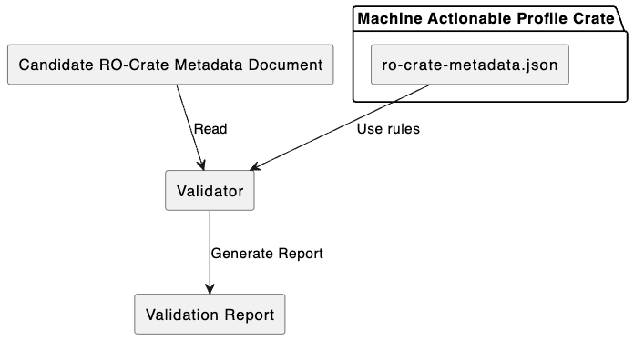

# RO-Crate Machine Actionable Schemas and Profile (Proof of concept)

> **The MASP validator has moved** to [crate-works/ro-crate-masp-validator](https://github.com/crate-works/ro-crate-masp-validator) and is published on npm as [`@crate-works/ro-crate-masp-validator`](https://www.npmjs.com/package/@crate-works/ro-crate-masp-validator). Report validator bugs and make validator changes there; this repository now uses it as a dependency.

## About this repo

This repository is for the development of RO-Crate Schemas and Profiles (RO-Crate-MASP) which implements the requirements set out in [The Notes] for RO-Crate Schemas and Machine Actionable Profiles.

[The Notes]: https://docs.google.com/document/d/17WRkGPIGtoQoSPlTbStBKUyHTzjrOZb620S1gdk0ei8/edit?tab=t.0#heading=h.5vdkev2g6ira 

We have some [discussion here](./docs/requirements-coverage.md) on how this solution addresses [The Notes].

This work builds on previous prototyping by PT Sefton under the banner "SoSS+". This work is hosted on a branch on the Language Data Commons [RO-Crate-Schema-Tools repo](https://github.com/Language-Research-Technology/ro-crate-schema-tools/tree/sossplus). That branch has a variety of bits of code and prototype schemas and profiles that are in various states of repair.

Now that the work is more advanced, I'm moving it to this repository as a "clean" copy where people will be able to try out working code in a more predictable environment on the main branch.

If this work goes forward then this repository will probably turn into the home of a javascript/Node implementation of an RO-Crate based *RO-Crate Machine Actionable Profiles and Schemas* spec.

## Reorganisation in progress

This repository is being pared back to just the core MASP spec; tools, examples and the validator are moving to their own repositories. See [plan.md](plan.md) for the steps. Moved so far:

- **Schema template** (`schemas/template`) → [masp-templates](https://github.com/Language-Research-Technology/masp-templates)
- **Validator** (`lib/masp-validator.js`, its tests, and `validate-crate.js`) → [crate-works/ro-crate-masp-validator](https://github.com/crate-works/ro-crate-masp-validator), on npm as `@crate-works/ro-crate-masp-validator`
- **Tools** (`generate-masp-docs.js`, `lib/register-rules.js`, the mode-file, schema.org and OWL converter scripts, and their tests) → [crate-works/ro-crate-masp-tools](https://github.com/crate-works/ro-crate-masp-tools), installed here as a dev dependency; the `build:*` scripts call it
- **Examples** (every profile except the MASP profile, all of `schemas/`, the catalogue and landing page, and their tests) → [ro-crate-masp-examples](https://github.com/Language-Research-Technology/ro-crate-masp-examples), published at https://language-research-technology.github.io/ro-crate-masp-examples/. Their old addresses on this site still work: each HTML page redirects to its new home, and the `ro-crate-metadata.json` files stay here as frozen copies.

## Example Profiles and Schemas

The example profiles and schemas are now in [ro-crate-masp-examples](https://github.com/Language-Research-Technology/ro-crate-masp-examples). Browse them on the **[examples landing page](https://language-research-technology.github.io/ro-crate-masp-examples/)**.

## What is here

This repository contains:
- Draft Profiles and Schemas, according to the definitions in [The Notes] which are packaged as RO-Crates, with schema rules included as *Contextual Entities*
  - *Start Here*: There is a [draft profile for _RO-Crate Machine Actionable Schemas and Profile_](profiles/ro-crate-masp/profile-crate/profile-documentation.md) which acts as an introduction.
  - We have a complete copy of Schema.org's schema - which imports without change into RO-Crate-MASP -- here's the Schema.org [documentation](https://language-research-technology.github.io/ro-crate-masp-examples/schemas/schema-org/schema-crate/index.html)
- Code (with unit tests) to demonstrate
    - Generating Profile or Schema documentation from a ROC-MASP crate.
    - Validating candidate RO-Crates against a ROC-MASP crate (initial implementation is as Unit-tests only)
        - TODO: Command line validator
    - TODO: Generating Editor (Crate-O) configuration from ROC-MASP crates we have code but it is out of date

### Things to look at

- Port of the [Workflow RO-Crate Profile 1.0](https://about.workflowhub.eu/Workflow-RO-Crate/): [experimental new version](https://language-research-technology.github.io/ro-crate-masp-examples/profiles/workflow/profile-crate/index.html), in the examples repository.
- Profile for the small number of metadata requirements for RO-Crate itself: [experimental new version](https://language-research-technology.github.io/ro-crate-masp-examples/profiles/ro-crate/profile-crate/index.html), in the examples repository.

## Architecture of the solution

The core of this proposed ROC-MASP solution is to use RO-Crates to package Profiles (or Schemas -- which can be authored in the same way but which would typically be more permissive).

This ROC-MASP Crate can be used in combination with textual summary of the Profile to create documentation with an automatically generated summary of what should be in conformant crates.

<!--
@startuml

package "Machine Actionable Profile Crate" as mapc {
rectangle "ro-crate-metadata.json" as rcd
rectangle "Profile summary document" as psd
}

rectangle "Human-readable text description of profile (profile.txt)" as pt

rectangle "Doc generation script"  as dgs

dgs <-up- rcd : Use rules
dgs <-up- pt : Use text
dgs -up-> psd : Generate Documentation


@enduml
-->


## Constraint Modeling Note

Rule constraints that assert literal values are modeled via `PropertyValue` entities referenced from a property's `rangeIncludes`.

- Do not put constraint literals directly on `rdf:Property` rules using a `value` field.
- Define a `PropertyValue` entity with a clear name and its `value` (literal, `@id` object, or regex literal string).
- Reference that `PropertyValue` from the relevant property rule through `rangeIncludes`.

This pattern is now the canonical way to express fixed and pattern-based value constraints in this repository.

## Running the tests

```bash
npm test                                   # run all tests
npx mocha test/mode-file.test.js           # run a single test file
```

The tests here check the MASP profile's Crate-O mode file. The validator, the tools and the examples each have their own tests in their own repositories.

## Building documentation

```bash
npm run build    # regenerates the MASP profile's documentation
```

This runs `generate-masp-docs` from [ro-crate-masp-tools](https://github.com/crate-works/ro-crate-masp-tools) with `-x`, which first syncs `ro-crate-metadata.json` and `ro-crate-metadata.xlsx` (the newer file wins). See that repository for its options and the other tools: Crate-O mode files, and converters from OWL and schema.org.

Validators use a ROC-MASP crate as a set of rules:

<!--
@startuml

package "Machine Actionable Profile Crate" as mapc {
rectangle "ro-crate-metadata.json" as rcd
}

rectangle "Candidate RO-Crate Metadata Document" as roc

rectangle "Validator"  as dgs

rectangle "Validation Report" as vr

dgs <-up- rcd : Use rules
dgs <-up- roc : Read
dgs -down-> vr : Generate Report


@enduml
-->




## Validating RO-Crates from the Command Line

You can validate a target RO-Crate against a profile crate or schema using `masp-validate`, the command-line tool from [`@crate-works/ro-crate-masp-validator`](https://github.com/crate-works/ro-crate-masp-validator) .

### Usage

```bash
npx masp-validate [--json] <target-crate.json> <profile-crate.json>
```

The [examples repository](https://github.com/Language-Research-Technology/ro-crate-masp-examples) has worked examples, such as validating its minimal workflow crate against the workflow profile.

The tool will print validation results to the console and exit with a nonzero code if errors are found.


## Help wanted!

We would love to see alternative implementations of this proof of concept code. Particularly other approaches to validation -- can ROC-MASP schemas and classes be transformed into SCHACL? 
