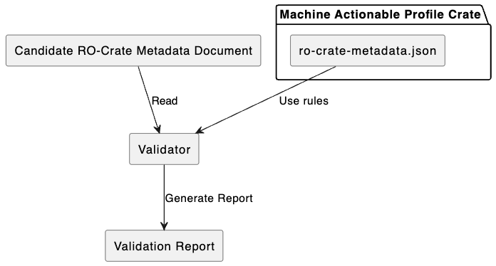

# RO-Crate Machine Actionable Schemas and Profile (Proof of concept)

## About this repo

This repository is for the development of RO-Crate Schemas and Profiles (RO-Crate-MASP) which implements the requirements set out in [The Notes] for RO-Crate Schemas and Machine Actionable Profiles.

[The Notes]: https://docs.google.com/document/d/17WRkGPIGtoQoSPlTbStBKUyHTzjrOZb620S1gdk0ei8/edit?tab=t.0#heading=h.5vdkev2g6ira 

We have some [discussion here](./docs/requirements-coverage.md) on how this solution addresses [The Notes].

This work builds on previous prototyping by PT Sefton under the banner "SoSS+". This work is hosted on a branch on the Language Data Commons [RO-Crate-Schema-Tools repo](https://github.com/Language-Research-Technology/ro-crate-schema-tools/tree/sossplus). That branch has a variety of bits of code and prototype schemas and profiles that are in various states of repair.

Now that the work is more advanced, I'm moving it to this repository as a "clean" copy where people will be able to try out working code in a more predictable environment on the main branch.

If this work goes forward then this repository will probably turn into the home of a javascript/Node implementation of an RO-Crate based *RO-Crate Machine Actionable Profiles and Schemas* spec.

## Example Profiles and Schemas

> **Examples only.** These profiles and schemas are working examples for developing and testing MASP. This repository is not their permanent home: each will eventually be published and maintained elsewhere, so don't rely on these copies or their URLs.

Browse and filter them all on the **[example profiles and schemas landing page](https://language-research-technology.github.io/ro-crate-masp/)**, or use the table below. Each name links to the published documentation on GitHub Pages; "Build" is the command that regenerates that documentation.

<!-- catalogue:start -->
<!-- Generated by scripts/build-catalogue.js; do not edit by hand. -->

| Name | Type | Notes | Classes / properties | Build | Description |
| ---- | ---- | ----- | -------------------- | ----- | ----------- |
| [Climate Change Adaptation RO-Crate Profile](https://language-research-technology.github.io/ro-crate-masp/profiles/cca-demo/profile-crate/index.html) | Profile |  | 3 / 51 | `npm run build:cca-profile` | A RO-Crate Profile defining conventions, contextual entities, and semantic terms for representing FAIR Digital Objects for Climate Change Adaptation research in FAIR2Adapt. |
| [Language Data Commons Comprehensive Collection Profile](https://language-research-technology.github.io/ro-crate-masp/profiles/ldac/profile-crate/index.html) | Profile |  | 30 / 99 | `npm run build:ldac-profile` | Profile derived from Language Data Commons Comprehensive Collection: Implements the language data commons RO-Crate Metadata Profile for the top-level, objects and files. |
| [LDAC-DMLex Profile (DRAFT)](https://language-research-technology.github.io/ro-crate-masp/profiles/ldac-dmlex/profile-crate/index.html) | Profile | DRAFT | 33 / 164 | `npm run build:ldac-dmlex-profile` | DRAFT: a Language Data Commons (LDAC) adaptation of the OASIS DMLex data model for lexicography. |
| [RO-Crate Machine Actionable Profile](https://language-research-technology.github.io/ro-crate-masp/profiles/ro-crate/profile-crate/index.html) | Profile |  | 3 / 6 | `npm run build:ro-crate-profile` | This is a mini-profile for RO-Crate itself |
| [RO-Crate 2.0 ExperimentalMachine Actionable Profile](https://language-research-technology.github.io/ro-crate-masp/profiles/ro-crate-2/profile-crate/index.html) | Profile | EXPERIMENTAL | 4 / 7 | `npm run build:ro-crate-2-profile` | This is an experimental profile for RO-Crate 2 |
| [RO-Crate MASP Profile](https://language-research-technology.github.io/ro-crate-masp/profiles/ro-crate-masp/profile-crate/index.html) | Profile |  | 13 / 29 | `npm run build:ro-crate-masp-profile` | Profile for RO-Crate Machine Actionable Profiles and Schemas (MASP). |
| [RO-Crate Photo Collection Profile](https://language-research-technology.github.io/ro-crate-masp/profiles/rocphotos/profile-crate/index.html) | Profile |  | 20 / 65 | `npm run build:rocphotos-profile` | Photograph collections kept at rest on a filesystem as nested RO-Crates: a root crate describing the collection and the people in it, a crate per sub-collection of photos, and a companion crate of face-recognition… |
| [RO-Crate + Schema.org Profile](https://language-research-technology.github.io/ro-crate-masp/profiles/schema-org/profile-crate/index.html) | Profile |  | 936 / 1528 |  | A self-contained RO-Crate profile with the minimal RO-Crate entry constraints and embedded Schema.org schema terms. |
| [DEMO ONLY: Research Software Description Profile Schema](https://language-research-technology.github.io/ro-crate-masp/profiles/software/profile-crate/index.html) | Profile | DEMO | 10 / 27 | `npm run build:software-profile` | Schema derived from DEMO ONLY: Research Software Description Profile: A draft Crate-O Mode for describing research software source code / notebooks / workflows |
| [Workflow Profile](https://language-research-technology.github.io/ro-crate-masp/profiles/workflow/profile-crate/index.html) | Profile | EXPERIMENTAL | 9 / 19 | `npm run build:workflow-profile` | This is an experimental port of the RO-Crate Workflow Profile to a proposed 'RO-Crate Schema' format. |
| [AusTalk Vocabulary Terms](https://language-research-technology.github.io/ro-crate-masp/schemas/austalk/schema-crate/index.html) | Schema |  | 3 / 84 | `npm run build:austalk-schema` | This is a language data ontology based on the AusTalk ontology here: https://github.com/Alveo/bigasc-metadata/edit/master/schema/austalk.owl |
| [CLDF Ontology](https://language-research-technology.github.io/ro-crate-masp/schemas/cldf/schema-crate/index.html) | Schema | from OWL | 23 / 59 | `npm run build:cldf-schema` | The CLDF Ontology is an RDF vocabulary describing the dataset types, tables and columns specified in the CLDF standard. |
| [DMLex (OASIS Data Model for Lexicography)](https://language-research-technology.github.io/ro-crate-masp/schemas/dmlex/schema-crate/index.html) | Schema | from OWL | 33 / 71 | `npm run build:dmlex-schema` | DMLex, the OASIS Data Model for Lexicography (v1.0, OASIS Standard), models dictionaries ("lexicographic resources"): entries, senses, definitions, examples, pronunciations and inflected forms, plus optional modules… |
| [Language Data Commons Schema Terms](https://language-research-technology.github.io/ro-crate-masp/schemas/ldac/schema-crate/index.html) | Schema |  | 5 / 54 | `npm run build:ldac-schema` | This is a language data schema, in the style of the Schema.org schema. |
| [lemon (Lexicon Model for Ontologies)](https://language-research-technology.github.io/ro-crate-masp/schemas/lemon/schema-crate/index.html) | Schema | from OWL | 29 / 54 | `npm run build:lemon-schema` | Lemon: The lexicon model for ontologies is designed to allow for descriptions of lexical information regarding ontological elements and other RDF resources. |
| [Web Annotation Vocabulary](https://language-research-technology.github.io/ro-crate-masp/schemas/oa/schema-crate/index.html) | Schema | from OWL | 21 / 29 | `npm run build:oa-schema` | The Web Annotation ontology defines the terms of the Web Annotation vocabulary. |
| [Records in Context Ontology](https://language-research-technology.github.io/ro-crate-masp/schemas/ric/schema-crate/index.html) | Schema | from OWL | 107 / 555 | `npm run build:ric-schema` | The Records in Context Ontology (RiC-O) is published by the International Council on Archives (ICA) Expert Group on Archival Description (EGAD) as part of Records in Context, a conceptual model for archival description. |
| [Schema.org Vocabulary](https://language-research-technology.github.io/ro-crate-masp/schemas/schema-org/schema-crate/index.html) | Schema |  | 933 / 1521 | `npm run build:schema-org-schema` | The full schema.org vocabulary expressed as a MASP schema crate. |
| [Template RO-Crate Schema](https://language-research-technology.github.io/ro-crate-masp/schemas/template/schema-crate/index.html) | Schema | TEMPLATE | 1 / 1 | `npm run build:template-schema` | This is a template for an RO-Crate schema. |

<!-- catalogue:end -->

## What is here

This repository contains:
- Draft Profiles and Schemas, according to the definitions in [The Notes] which are packaged as RO-Crates, with schema rules included as *Contextual Entities*
  - *Start Here*: There is a [draft profile for _RO-Crate Machine Actionable Schemas and Profile_](profiles/ro-crate-masp/profile-crate/profile-documentation.md) which acts as an introduction.
  - We have a complete copy of Schema.org's schema - which imports without change into RO-Crate-MASP -- here's the Schema.org [documentation](https://language-research-technology.github.io/ro-crate-masp/schemas/schema-org/schema-crate/index.html)
- Code (with unit tests) to demonstrate
    - Generating Profile or Schema documentation from a ROC-MASP crate.
    - Validating candidate RO-Crates against a ROC-MASP crate (initial implementation is as Unit-tests only)
        - TODO: Command line validator
    - TODO: Generating Editor (Crate-O) configuration from ROC-MASP crates we have code but it is out of date

### Things to look at

- Port of the [Workflow RO-Crate Profile 1.0](https://about.workflowhub.eu/Workflow-RO-Crate/). [Experimental New Version](./profiles/workflow/profile-crate/profile-documentation.md). The markdown document lists its own provenance like so:
    > This document was compiled using [generate-soss-docs.js](https://github.com/Language-Research-Technology/ro-crate-schema-tools/blob/main/generate-soss-docs.js), based on [profiles/workflow/profile-text.md](https://github.com/Language-Research-Technology/ro-crate-schema-tools/blob/main/profiles/workflow/profile-text.md) using a SoSS+ Schema defined in [profiles/workflow/profile-crate/ro-crate-metadata.json](https://github.com/Language-Research-Technology/ro-crate-schema-tools/blob/main/profiles/workflow/profile-crate/ro-crate-metadata.json).

    See the [Excel version](profiles/workflow/profile-crate/ro-crate-metadata.xlsx) of the Profile rules.

- Profile for the small number of metadata requirements for RO-Crate itself: [Experimental new version](./profiles/ro-crate/profile-crate/profile-documentation.md).
    > This document was compiled using [generate-soss-docs.js](https://github.com/Language-Research-Technology/ro-crate-schema-tools/blob/main/generate-soss-docs.js), based on [profiles/ro-crate/profile-text.md](https://github.com/Language-Research-Technology/ro-crate-schema-tools/blob/main/profiles/ro-crate/profile-text.md) using a SoSS+ Schema defined in [profiles/ro-crate/profile-crate/ro-crate-metadata.json](https://github.com/Language-Research-Technology/ro-crate-schema-tools/blob/main/profiles/ro-crate/profile-crate/ro-crate-metadata.json).


We would love to see alternative implementations of this proof of concept code. Particularly other approaches to validation -- can ROC-MASP schemas and classes be transformed into SHACL? 

## Architecture of the solution

The core of this proposed ROC-MASP solution is to use RO-Crates to package Profiles (or Schemas -- which can be authored in the same way but which would typically be more permissive).

This ROC-MASP Crate can be used in combination with textual summary of the Profile to create documentation with an automatically generated summary of what should be in conformant crates.

<!--
@startuml

package "Machine Actionable Profile Crate" as mapc {
rectangle "ro-crate-metadata.json" as rcd
rectangle "Profile summary document" as psd
}

rectangle "Human-readable text description of profile (profile.txt)" as pt

rectangle "Doc generation script"  as dgs

dgs <-up- rcd : Use rules
dgs <-up- pt : Use text
dgs -up-> psd : Generate Documentation


@enduml
-->


## Constraint Modeling Note

Rule constraints that assert literal values are modeled via `PropertyValue` entities referenced from a property's `rangeIncludes`.

- Do not put constraint literals directly on `rdf:Property` rules using a `value` field.
- Define a `PropertyValue` entity with a clear name and its `value` (literal, `@id` object, or regex literal string).
- Reference that `PropertyValue` from the relevant property rule through `rangeIncludes`.

This pattern is now the canonical way to express fixed and pattern-based value constraints in this repository.

## Running the tests

```bash
npm test                                   # run all tests (~38)
npx mocha test/ldac-validator.test.js      # run a single test file
```

Tests use real profile crates from `profiles/` and sample crates from `test_data/`, so changes to either will affect test results.

## Building documentation

To run this, choose one of the examples from the implementations section below. E.g. to generate the documentation for the RO-Crate Workflow profile example, run:

```javascript
npm run build:workflow-profile
```

Or to validate an example workflow crate: 
```
npm run validate:workflow 
```

To get the full validation report (which is a work in progress):

```
npm run validate:workflow:json
```

NOTE: At the moment these scripts are passing in the profile to validate against. TOTO: In future the code will support fetching or matching local copies of profiles by IRI on a conformsTo property.

Similarly, validators can use a ROC-MASP crate as a set of rules:

<!--
@startuml

package "Machine Actionable Profile Crate" as mapc {
rectangle "ro-crate-metadata.json" as rcd
}

rectangle "Candidate RO-Crate Metadata Document" as roc

rectangle "Validator"  as dgs

rectangle "Validation Report" as vr

dgs <-up- rcd : Use rules
dgs <-up- roc : Read
dgs -down-> vr : Generate Report


@enduml
-->




## Building Profile and Schema documentation

This repository includes several profiles and schemas that can be built using npm scripts. Each build command generates documentation from the RO-Crate metadata.

### Available Build Commands

Each profile and schema's build command is in the "Build" column of the [Example Profiles and Schemas](#example-profiles-and-schemas) table above. `npm run build` builds them all. `npm run build:catalogue` regenerates that table, and the `catalogue.json` the landing page reads, from the crates themselves.

### Usage note: spreadsheet synchronisation

- **Flag**: `-x` or `--rocxl` — when running `generate-masp-docs` for profiles or schemas, you can pass `-x` to synchronise `ro-crate-metadata.json` and `ro-crate-metadata.xlsx` first. The generator will choose the newer of the two files and update the other; if only the spreadsheet exists, the JSON will be created from it. It will then generate documentation from the JSON file as usual. When syncing from the spreadsheet, any `rdfs:Class`, `rdf:Property`, `ItemList`, `PropertyValue` or `DefinedTermSet` row not yet listed in the schema `ResourceDescriptor`'s `hasPart` is added to it automatically, and the spreadsheet is regenerated with a warning — if it is open in Excel, close it without saving and reopen it.

  This is done in-process via the [`ro-crate-excel`](https://github.com/Language-Research-Technology/ro-crate-excel) package's `Workbook` API (a regular npm dependency), not by shelling out to its `rocxl` command-line tool — `rocxl` also recursively catalogues data files in the target directory using the external `sf` (Siegfried) binary, which MASP schema/profile crates (metadata-only, no data files) don't need and which isn't installed in every environment.

Example:

```bash
npm exec -- generate-masp-docs -- profiles/ldac/profile-crate/ro-crate-metadata.json profiles/ldac/profile-text.md profiles/ldac/profile-crate/profile-documentation.md -x
```


Each build command runs the `generate-soss-docs.js` script with three arguments:
1. Path to the `ro-crate-metadata.json` file
2. Path to the profile/schema text markdown file
3. Path to the output documentation markdown file


## Converting an OWL ontology to a MASP schema

`scripts/owl-to-masp.py` converts an OWL ontology (RDF/XML, Turtle, or JSON-LD) into a MASP schema crate — see [`scripts/owl-to-masp.spec.md`](scripts/owl-to-masp.spec.md) for the full design spec and mapping rules. It's a Python script run via [`uv`](https://docs.astral.sh/uv/) rather than Node, since OWL/RDF parsing is much better supported there (`rdflib`) than in the JS ecosystem the rest of this repo uses.

This is a one-off, manually-run tool — it's deliberately **not** wired into `package.json` (there's no `build:*`/`generate:*` script for it), since converting a new ontology is a rare, deliberate action you review by hand afterwards, not something that should re-run on every `npm run build`.

To convert an ontology, point it at the source file (a path or URL) and an output directory under `schemas/`:

```bash
uv run scripts/owl-to-masp.py \
  --input https://www.ica.org/standards/RiC/RiC-O_1-1.rdf \
  --output-dir schemas/ric \
  --namespace "https://www.ica.org/standards/RiC/ontology#" \
  --name "Records in Context Ontology"
```

This is exactly the command used to generate [`schemas/ric`](schemas/ric) (the Records in Context Ontology, RiC-O) from its published OWL source. `--namespace` restricts conversion to terms defined by the ontology itself, excluding anything it imports from other vocabularies (SKOS, Dublin Core, etc.) — without it, the converter would also try to re-mint schema entities for every imported term. The generated `schema-crate/` directory bundles the original OWL file alongside `ro-crate-metadata.json`, along with a `CreateAction` recording that this script produced the crate from that file, so the result is self-contained and its provenance is traceable without depending on the source URL remaining live.

After conversion, review the generated `schema-text.md` stub and fill in a proper description, then build documentation as usual — for RiC-O that's `npm run build:ric-schema` (see [Available Build Commands](#available-build-commands) above), which also syncs (`-x`) to produce an Excel copy of the rules alongside the JSON.

The converter's own test suite (`test/owl-to-masp/test_owl_to_masp.py`, run via `npm run test:owl-to-masp`) runs against a small fixture ontology, not the full RiC-O file — see the spec for why, and for the workflow used to extend it when converting a new ontology surfaces a construct the fixture doesn't yet cover.

## Validating RO-Crates from the Command Line

You can validate a target RO-Crate against a profile crate or schema using the command-line tool `validate-crate.js`.

### Usage

```bash
node validate-crate.js <target-crate.json> <profile-crate.json>
```

For example, to validate the minimal workflow crate against the workflow profile:

```bash
node validate-crate.js profiles/workflow/examples/minimal-example/ro-crate-metadata.json profiles/workflow/profile-crate/ro-crate-metadata.json
```

The tool will print validation results to the console and exit with a nonzero code if errors are found.


## Help wanted!

We would love to see alternative implementations of this proof of concept code. Particularly other approaches to validation -- can ROC-MASP schemas and classes be transformed into SCHACL? 
